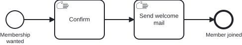

# Aufgabe 1 – Die Engine zum Laufen bringen

> **Voraussetzung:** Aufgabe 0 ist abgeschlossen (der Kernablauf liegt fachlich vor).
> **Arbeitsverzeichnis:** `services/process-application`
> **Neu in dieser Aufgabe:** Operaton-Starter, Engine-Konfiguration, Embedded-Datenbank (H2), Auto-Deployment, Cockpit, H2-Konsole, `act_*`-Tabellen, Start-Formular, Manual Task, EnterpriseGlue The Bridge (optionale zusätzliche UI).

## Darum geht es

Bevor du den Kernablauf aus Aufgabe 0 automatisierst, bringst du die Engine einmal zum Laufen. Dafür
liegt ein bewusst winziger Ausschnitt bereit: ein Start-Formular für die Anmeldedaten, danach zwei
**Manual Tasks** „Confirm" und „Send welcome mail". Die Engine läuft durch Manual Tasks einfach
hindurch, so bekommst du ohne eine Zeile Code eine Instanz, die vollständig durchläuft. Ab Aufgabe 2
baust du die Platzhalter zu echten Schritten aus.

## Lernziele

Nach dieser Aufgabe kannst du

- ein Spring-Boot-Modul mit eingebetteter Operaton-Engine lauffähig machen,
- dich im Cockpit zwischen Processes, Tasklist und Admin bewegen,
- die `act_*`-Tabellen den Kategorien Repository, Runtime und History zuordnen,
- eine Instanz über ein **Start-Formular** starten und erklären, warum sie an **Manual Tasks** nicht anhält.

## Ziel-Modell



Das Modell liegt fertig unter `services/process-application/src/main/resources/bpmn/membership.bpmn`.
Du modellierst in dieser Aufgabe nichts.

## Aufgabe

### 1. Dependencies aktivieren

Kommentiere in `services/process-application/pom.xml` den Block `TODO Exercise 1` mit den beiden
Operaton-Startern (`webapp` und `rest`) ein. Lösche dafür nur die Zeilen `<!--` und `-->`
zwischen `<!-- @exercise-1:begin … -->` und `<!-- @exercise-1:end -->`. Die Marker bleiben stehen,
der Task `load-solution` braucht sie.

### 2. Konfiguration aktivieren

Kommentiere in `src/main/resources/application.yaml` den Block `TODO Exercise 1` ein. Er enthält:

- die Anbindung an eine H2-Datenbank in der Datei `~/.operaton-training/exercise` (Benutzer `sa`,
  leeres Passwort),
- die **H2-Konsole**, eine SQL-Oberfläche im Browser,
- den Cockpit-Admin-User (`admin` / `admin`).

Fehlt der Block, startet die Anwendung trotzdem, aber auf einer flüchtigen In-Memory-H2: ohne
Admin-User, ohne H2-Konsole, und nach einem Neustart sind alle Daten weg.

> **Begriff: Embedded-Datenbank.** Eine Datenbank, die als Bibliothek im selben Prozess wie die
> Anwendung läuft statt als eigener Server. Du installierst nichts: H2 legt die Datei beim ersten
> Start an, die Engine erzeugt darin ihre `act_*`-Tabellen selbst. Weil H2 in eine Datei schreibt,
> übersteht der Datenbestand einen Neustart.

### 3. Anwendung scharf schalten

Aktiviere in `TrainingApplication.java` die Annotationen `@SpringBootApplication` und
`@EnableJpaRepositories`. Danach greifen Auto-Configuration und Auto-Deployment: Alle `*.bpmn` unter
`src/main/resources` werden beim Start in die Engine deployt.

### 4. Anwendung starten

Starte die Anwendung und beobachte im Log, wie die Engine hochfährt und das Modell deployt:

```bash
cd services/process-application && ../../mvnw spring-boot:run
```

### 5. Die Tabellen der Engine ansehen

Öffne [http://localhost:8080/h2-console](http://localhost:8080/h2-console), ersetze im Feld
**JDBC URL** den vorbelegten Wert `jdbc:h2:~/test` durch `jdbc:h2:file:~/.operaton-training/exercise`
und klicke mit Benutzer `sa` und leerem Passwort auf **Connect**. Diese fünf Tabellen sind die
wichtigsten:

| Tabelle | Präfix | Inhalt |
|---|---|---|
| `act_re_procdef` | `re` = Repository | deployte **Prozessdefinitionen** (`subscribeNewsletter`) |
| `act_ru_execution` | `ru` = Runtime | **laufende** Prozessinstanzen |
| `act_ru_task` | `ru` | offene **User Tasks** |
| `act_ru_variable` | `ru` | **Prozessvariablen** laufender Instanzen |
| `act_hi_procinst` | `hi` = History | **abgeschlossene** Prozessinstanzen |

Prüfe mit dieser Abfrage, ob dein Modell deployt wurde:

```sql
SELECT key_, name_, version_ FROM act_re_procdef;
```

### 6. Cockpit erkunden

Öffne [http://localhost:8080/operaton/app/cockpit/](http://localhost:8080/operaton/app/cockpit/)
(admin / admin). Unter **Processes** erscheint `Join Inner Circle`, der Anzeigename zum
Prozess-Key `subscribeNewsletter`. Klick dich durch **Cockpit**, **Tasklist** und **Admin**.

### 7. Prozess durchspielen

Starte in der **Tasklist** über **Start process** → `Join Inner Circle` eine Instanz. Die Tasklist
zeigt ein **Start-Formular** mit `email`, `name` und `age`. Fülle es aus und starte. Die Instanz läuft
ohne anzuhalten bis zum Ende, danach steht sie in `act_hi_procinst` auf `COMPLETED`, und `act_ru_*`
ist leer.

> **Begriff: Start-Formular (Generated Form).** Die Felder stehen als `camunda:formData` am Start
> Event. Die Tasklist rendert daraus ein Formular, die eingegebenen Werte werden zu
> Prozessvariablen.

> **Begriff: Manual Task.** Ein Task, den die Engine weder ausführt noch an ihm wartet, ein
> Platzhalter für „hier passiert später etwas".

### 8. Optional: EnterpriseGlue The Bridge verbinden

Die Bridge ist eine zusätzliche Weboberfläche für die Engine, ergänzend zum Cockpit. Keine Aufgabe
setzt sie voraus. Sie ist der einzige Teil des Trainings, für den du Docker brauchst: Die Container
beschreibt `stack/docker-compose.yml`. Fahre sie in einem zweiten Terminal hoch, die Anwendung läuft
im ersten weiter:

```bash
cd stack && docker-compose up -d
```

1. Öffne [http://localhost:8081](http://localhost:8081) und melde dich mit dem Dev-Admin an
   (`admin@enterpriseglue.com` / `adminadmin`).
2. Registriere die Engine unter **Platform settings → Engines → Add engine**:

   | Feld | Wert |
   |---|---|
   | Engine name | `Training` (frei wählbar) |
   | Engine product | `Operaton` |
   | How EnterpriseGlue connects | `Connect directly to the engine` |
   | Endpoint URL | `http://host.docker.internal:8080/engine-rest` |
   | Endpoint authentication | `Username and password` → Username `admin`, Password `admin` |
   | Environment label | `Dev` (vorausgewählt) |

   Alles andere bleibt auf den Vorgaben. Die Endpoint-URL ist dieselbe REST-Schnittstelle, die auch
   das Cockpit nutzt. Aus dem Container heraus ist der Host über `host.docker.internal` erreichbar,
   nicht über `localhost`.
3. Nach **Create** steht die Engine auf **Connected**, und `Join Inner Circle` erscheint unter
   **Mission Control**.

> **Begriff: EnterpriseGlue The Bridge.** Eine zusätzliche UI für die Engine (BPMN/DMN
> modellieren, deployen und verwalten). Sie spricht dieselbe `engine-rest`-API wie das Cockpit. Die
> Trainings-Engine ignoriert die Zugangsdaten; die Bridge speichert eine direkt verbundene Engine aber
> nur mit Zugangsdaten, deshalb `admin`/`admin` aus der `application.yaml`.

## Randbedingungen

- Die Business-Schicht der hexagonalen Architektur ist im Modul schon angelegt, aber auskommentiert.
- Alle Module laufen auf Port `8080` und nutzen dieselbe H2-Datei. Starte immer nur eines, die
  laufende Anwendung sperrt die Datei.
- Docker brauchst du nur für den optionalen Schritt 8 (Bridge).

## Erwartetes Ergebnis

Im Log erscheinen `Auto-Deploying resources: [... membership.bpmn]` und `Started TrainingApplication`.
`Join Inner Circle` steht im Cockpit unter **Processes**, und eine gestartete Instanz läuft bis zum
End Event durch.

## Selbstcheck

- [ ] Dependencies, Konfiguration und `@SpringBootApplication` sind aktiviert
- [ ] Die Anwendung startet, `act_re_procdef` enthält `subscribeNewsletter`
- [ ] `Join Inner Circle` erscheint im Cockpit unter **Processes**
- [ ] Eine über das Start-Formular gestartete Instanz steht in der History auf `COMPLETED`
- [ ] Du kannst erklären, warum die Instanz an den Manual Tasks nicht wartet
- [ ] Optional: Die Bridge unter `http://localhost:8081` zeigt nach dem Verbinden `Join Inner Circle`

## Hinweise

- Zeigt das Cockpit statt der Anmeldung die Seite **Operaton Setup** zum Anlegen eines ersten
  Users, ist der Block in der `application.yaml` noch auskommentiert (im Log steht `jdbc:h2:mem:…`
  statt der H2-Datei). Leg dort keinen User an, sondern kommentiere den Block ein und starte neu.
- `Database may be already in use: "…/.operaton-training/exercise.mv.db"`: Eine andere Anwendung
  läuft auf derselben Datei. Beende sie. Aus demselben Grund öffnen externe Datenbank-Werkzeuge die
  Datei nicht, solange die Anwendung läuft.
- Für einen sauberen Neuanfang beende die Anwendung und lösche `~/.operaton-training` (Windows:
  `%USERPROFILE%\.operaton-training`).
- **Bridge (Schritt 8):** Meldet `docker logs enterpriseglue-backend` beim Anlegen der Engine
  `Engine base URL must use HTTPS when endpoint policy is enforced`, läuft das Backend ohne die
  `EG_ENGINE_*`-Variablen aus `stack/docker-compose.yml`; führe `cd stack && docker-compose up -d`
  erneut aus. `Engine base URL private host must have an exact endpoint-policy allowlist entry`
  heißt, dass `localhost` statt `host.docker.internal` eingetragen wurde.
- **Bridge (Schritt 8):** Bricht `docker-compose up -d` mit
  `container enterpriseglue-backend is unhealthy` ab und zeigt das Log eine fehlgeschlagene Migration
  (z. B. `column "user_id" does not exist`), stammen die Bridge-Volumes von einem älteren Image.
  Setze sie zurück oder spiele einmalig `stack/enterpriseglue-ledger-baseline-v0.19.2.sql` ein;
  beide Rezepte stehen im Kopf dieser Datei.

## Referenzlösung

`../../solutions/exercise-01/` – oder direkt laden:

```bash
./mvnw -pl services/process-application antrun:run@load-solution -Dsolution=01
```

Der Task sichert deinen Stand unter `services/process-application/.load-solution-backup/` und setzt
`src/` und `pom.xml` auf den Stand nach Aufgabe 1. Lade danach in IntelliJ das Maven-Projekt neu.

## Nächster Schritt

In Aufgabe 2 werden die Platzhalter zu einem echten User Task und einem Service Task.

➡️ [Weiter zu Aufgabe 2](exercise-02.md)
